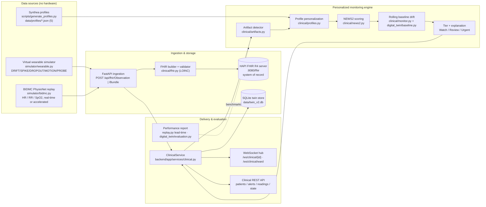

# PS-03 — Personalized Post-Discharge Deterioration Monitor
## First-Round Technical & Presentation Document

**Event:** MineArena 1.0 · Code Commit · BIET Davangere · 24-Hour On-Site Hackathon (12–13 Nov 2026)
**Team:** Torque Titans
**Domain:** HealthTech & Digital Health
**Repository:** Human Health Digital Twin (this repo)

> ⚠️ **Clinical decision support, not medical diagnosis.** Synthetic data only.
> This statement is displayed in the UI and embedded in every generated alert.

---

## 1. One-line pitch

We continuously ingest wearable vital signs as **FHIR R4 Observations**, store them in a
**HAPI FHIR server**, and score them with a **personalized NEWS2-style engine** that combines
each patient's **Synthea discharge profile** (conditions + medications) with their **own rolling
baseline** — so we catch *gradual* deterioration early, **suppress sensor-artifact false alerts**,
and emit **Watch / Review / Urgent** alerts that each explain *the reading, the rule, and the
profile fact* behind them.

---

## 2. What we built (executive summary)

- **FHIR R4 ingestion API** (`POST /api/fhir/Observation`, `/api/fhir/Bundle`) with correct
  Vital-Signs structure and LOINC coding; observations persisted to a **HAPI FHIR R4 server**.
- **Two software data sources**, no hardware:
  - a **virtual wearable simulator** with scripted sensor events (drift, spike, dropout, motion
    noise, probe removal), and
  - a **BIDMC PhysioNet replay** tool (real-time or accelerated).
- **5 Synthea-generated discharge profiles** (conditions + medications) that *change* scoring.
- **NEWS2-style scoring** with **3 personalization rules** (SpO₂ Scale 2, beta-blocker pulse
  correction, per-patient rolling baseline).
- **Sensor-artifact detection & false-alert suppression** (probe removal, flatline, implausible
  values, motion noise, dropouts) with a separate **device-offline** alert class.
- **Explained, tiered alerts** (Watch / Review / Urgent) carrying reading + rule + profile fact.
- **Scenario replay + performance report**: detection **lead time** and **alerts / false-alarms
  per patient-day**, benchmarked against a **naive fixed-threshold** monitor.
- Runs end-to-end on top of an existing digital-twin platform (FastAPI + React + SQLite +
  WebSockets), with a seeded pytest suite and a reproducible validation harness.

**Round-1 focus:** the clinical engine, FHIR pipeline, personalization, artifact suppression and
the measured comparison vs fixed thresholds — all demonstrable live via API / Swagger / WebSocket.
(The clinician *ward screen* is the next UI build; its data contract and WebSocket are already live.)

---

## 3. Problem recap & design goals

Post-discharge patients lose continuous monitoring. Remote vitals help, but raw thresholds
produce **alert fatigue**: sensor faults and normal activity look like deterioration. The challenge
is *deciding when a reading truly needs clinical attention*.

Design goals that follow from the PS:

| Goal | How we meet it |
|---|---|
| Standards-based ingestion | FHIR R4 Vital Signs + LOINC; HAPI FHIR as system of record |
| Personalization, not population-only | Discharge-profile rules + per-patient rolling baseline |
| Catch *gradual* decline | Sustained robust-z drift vs personal baseline, escalates tier |
| Reject bad sensors | Coherence/plausibility artifact detector; suppress clinical alerts |
| Explainability | Every alert = reading + rule + profile fact + narrative |
| Measurable benefit | Lead time & alerts/patient-day vs naive fixed thresholds |
| Safety framing | "Decision support, not diagnosis" everywhere |

---

## 4. System architecture

### 4.1 High-level component diagram



### 4.2 End-to-end sequence (PS §4, steps 1–10)

```mermaid
sequenceDiagram
  participant Src as Simulator / BIDMC replay
  participant API as FastAPI /api/fhir/*
  participant F as clinical/fhir.py
  participant H as HAPI FHIR :8080
  participant M as PersonalizedMonitor
  participant A as ArtifactDetector
  participant N as NEWS2 + profile + baseline
  participant Hub as WebSocket hub
  participant C as Clinician API / dashboard

  Src->>API: vital reading (HR, SpO2, RR, Temp)
  API->>F: build FHIR R4 Observation (LOINC)
  F->>H: store Observation / Bundle  (step 3-4)
  API->>M: process(observation)
  M->>A: assess (artifact?)          (step 8)
  alt sensor artifact / dropout
    A-->>M: suppress clinical; SENSOR / DEVICE_OFFLINE alert
  else trusted reading
    M->>N: personalize (SpO2 scale, beta-blocker) + NEWS2 + rolling drift  (step 5-6)
    N-->>M: tier Watch/Review/Urgent + explanation                        (step 9)
  end
  M->>Hub: publish patient + ward update
  Hub->>C: live alert / state / vitals                                    (step 10)
  Note over C: reading + rule + profile fact shown per alert
```

### 4.3 Layer / module map

| Layer | Module | Responsibility |
|---|---|---|
| Data source | `simulator/wearable.py` | Scripted virtual wearable; event layer over correlated physiology; seeded |
| Data source | `simulator/bidmc.py` | BIDMC PPG/Respiration replay; HR/RR/SpO₂; `speed` acceleration; no temp (per PS) |
| Data source | `simulator/generator.py`, `scenarios.py` | Physiology + history generation; named scenario scripts |
| Profiles | `scripts/generate_profiles.py`, `clinical/profiles.py` | Synthea → discharge profile; conditions/medications → personalization rules |
| Ingestion | `backend/app/api/clinical.py` | `POST /api/fhir/Observation`, `/Bundle`; clinical REST + ward WS |
| FHIR | `clinical/fhir.py` | Build/validate R4 Vital Signs Observations; LOINC + UCUM units |
| FHIR storage | `clinical/hapi_client.py` | Async HAPI client: ensure Patient, store Observation/Bundle, search |
| Engine | `clinical/artifacts.py` | Probe removal / flatline / implausible / motion / dropout; trust per metric |
| Engine | `clinical/news2.py` | NEWS2 bands, SpO₂ Scale 1 & 2, aggregate → Watch/Review/Urgent |
| Engine | `clinical/monitor.py` | Per-patient pipeline: artifact → personalize → NEWS2 → drift → tier + explanation |
| Engine | `digital_twin/baseline.py` | Robust center/spread (median / scaled-MAD) for rolling baseline |
| Orchestration | `backend/app/services/clinical.py` | Owns profiles + one monitor/patient; FHIR store; alert/readings buffers; hub publish |
| Orchestration | `backend/app/services/replay.py` | Scenario replay runner; per-patient **lead time** measurement |
| Storage | HAPI FHIR (`:8080`) | FHIR system of record for Patients + Observations |
| Storage | SQLite `data/twin_v2.db` | Longitudinal twin store (subjects, twins, observations, baselines, states) |
| Delivery | `backend/app/services/hub.py` | WebSocket fan-out: per-patient + ward channel |
| Evaluation | `digital_twin/evaluation.py` | Ground-truth validation + naive fixed-threshold ablation; alerts/false-alarms per day |
| Platform | `backend/app/factory.py`, `api/*`, `services/*` | FastAPI app, twin REST, live simulator, devices, system |

### 4.4 Technology stack

| Concern | Choice |
|---|---|
| Language / backend | Python 3.12 · FastAPI · Uvicorn |
| Real-time | WebSockets (in-process hub) |
| FHIR server | HAPI FHIR R4 (`:8080/fhir`) |
| Patient generation | Synthea |
| Dataset | PhysioNet BIDMC PPG & Respiration |
| Twin / longitudinal DB | SQLite (SQLAlchemy ORM) |
| Simulator | Custom seeded Python physiology + event layer |
| Frontend (existing platform) | React + TypeScript + Vite + Three.js |
| Validation | pytest · reproducible seeded evaluation harness |

---

## 5. Core clinical logic (the differentiators)

### 5.1 NEWS2-style baseline (`clinical/news2.py`)
Deterministic, auditable band scoring for respiratory rate, SpO₂, temperature, heart rate,
systolic BP and consciousness. Aggregate maps to **Watch / Review / Urgent**.
SpO₂ supports **Scale 1** and **Scale 2** (target **88–92%**), including the Scale-2
"on oxygen above target scores 0" nuance.

### 5.2 Personalization rules (`clinical/profiles.py` → `monitor.py`)
At least two are required; we implement **three**, each tied to a documented profile fact:

| Rule | Trigger (profile fact) | Effect |
|---|---|---|
| `spo2_scale_2` | Documented **hypercapnic respiratory failure** | SpO₂ scored on **Scale 2 (88–92%)** instead of Scale 1 |
| `beta_blocker_pulse` | **Beta-blocker** medication | Pulse corrected (+bpm) because beta-blockade blunts HR response |
| `rolling_baseline` | Patient's **own history** | Sustained drift from personal baseline escalates one tier |

Flags are *derived from Synthea conditions/medications* (e.g. hypercapnic markers, COPD + home
oxygen), not hand-waved — so the profile genuinely changes the score.

### 5.3 Rolling baseline & gradual deterioration (`monitor.py:140`)
- Trailing **7-day** window that **excludes the most recent 2 h**, so an ongoing decline cannot
  drag its own baseline along and hide itself.
- Center = **median**, spread = **scaled MAD** (artifact-tolerant), with per-metric spread floors.
- A vital moving in its deterioration direction with **robust z ≥ 3** for **≥3 consecutive
  readings** is a *drift finding*; drift **escalates one tier above** the NEWS2 aggregate.
- This is what catches slow deterioration while every single reading is still "in range".

### 5.4 Sensor-artifact detection & suppression (`clinical/artifacts.py`)
Discriminating principle: **genuine deterioration is coherent & physiologically plausible;
sensor faults are incoherent or impossible.**

| Kind | Signature |
|---|---|
| `PROBE_REMOVAL` | SpO₂ = 0 / null **and** heart rate flatlined |
| `FLATLINE` | Zero variance over a window (frozen signal) |
| `IMPLAUSIBLE` | Value outside life-compatible range (SpO₂ 0 handled as probe removal) |
| `MOTION_NOISE` | Large HR/SpO₂ jump during high activity intensity |
| `DROPOUT` | Gap ≫ device reporting cadence |

Untrusted metrics are **withheld from NEWS2** (not scored as real); clinical alerts are
**suppressed** and replaced by a **SENSOR** alert; long gaps become **DEVICE_OFFLINE** —
connectivity issues are never mistaken for clinical deterioration. Artifacts are still *reported*
so clinicians see the device needs attention.

### 5.5 Explainable alert contract (`monitor.py:91`)
Every alert carries exactly what PS §3.6 demands:
- **readings** — the contributing values, units, NEWS2 points / band (or drift z),
- **rules** — the personalization / suppression rules applied,
- **profile_facts** — the discharge-profile facts that triggered them,
- **narrative** — a plain-language summary ending with the not-a-diagnosis disclaimer.

---

## 6. Data sources & profiles

### 6.1 Virtual wearable simulator (`simulator/wearable.py`)
Configurable-rate streaming with explicit, seeded events: `DRIFT`, `SPIKE`, `DROPOUT`,
`MOTION_NOISE`, `PROBE_REMOVAL` (SpO₂ zero/null + HR flatline). **Body temperature is generated
here** (BIDMC has none). Named scripts: `stable_recovery`, `slow_deterioration`, `sensor_artifact`.

### 6.2 BIDMC replay (`simulator/bidmc.py`)
Replays recorded **HR / RR / SpO₂** from the open BIDMC PPG & Respiration dataset into the FHIR
ingestion API at **real time or accelerated** (`speed`). Temperature/BP intentionally absent.

### 6.3 Synthea discharge profiles (5) — `data/profiles/`

| Profile | Clinical theme | Assigned scenario |
|---|---|---|
| `p1_scale2_copd` | COPD / hypercapnic resp. failure → SpO₂ Scale 2 | `slow_deterioration` |
| `p2_beta_blocker` | Beta-blocker therapy → pulse correction | `slow_deterioration` |
| `p3_heart_failure` | Heart failure | `stable_recovery` |
| `p4_diabetes` | Diabetes | `sensor_artifact` |
| `p5_stable_recovery` | Stable recovery | `bidmc_replay` |

Generated from Synthea FHIR output (`data/synthea/output/fhir/`) via
`scripts/generate_profiles.py`; each carries conditions + medications that drive the rules above.

---

## 7. Requirement compliance matrix (PS §3)

| Req | Requirement | Status | Evidence |
|---|---|---|---|
| 3.1 | FHIR R4 ingestion API + HAPI storage + LOINC | ✅ | `clinical/fhir.py:37-40`; `hapi_client.py`; `POST /api/fhir/Observation`,`/Bundle` |
| 3.2A | Virtual wearable simulator + scripted events | ✅ | `simulator/wearable.py:30-35` (5 event kinds), temp generated |
| 3.2B | BIDMC replay, real-time/accelerated | ✅ | `simulator/bidmc.py` (`speed`), HR/RR/SpO₂ |
| 3.3 | ≥5 Synthea discharge profiles influencing scoring | ✅ | `data/profiles/` (5), `scripts/generate_profiles.py`, `profiles.py` rules |
| 3.4 | NEWS2 baseline + ≥2 personalization rules | ✅ | `news2.py` (Scale 2 88–92); `monitor.py` (3 rules incl. rolling baseline) |
| 3.5 | Artifact detection + false-alert suppression | ✅ | `artifacts.py` (5 kinds), suppression + DEVICE_OFFLINE |
| 3.6 | Clinician dashboard + tiered explained alerts | ⚠️ engine+API ready; ward UI next | `monitor.py:91` explanation; `/api/clinical/.../alerts`; `/ws/clinical/ward` |
| 3.7 | Scenario replay + performance report vs fixed-threshold | ✅ | `replay.py` lead-time; `evaluation.py` ablation + alerts/day |
| — | "Decision support, not diagnosis" displayed | ✅ | alert narrative + UI |

**Optional hints:** missing-data alerts ✅ (`DEVICE_OFFLINE`); symptom check-ins, FHIR
Flag/CommunicationRequest escalation, Kannada/Hindi notifications = roadmap (not yet built).

---

## 8. Performance evaluation (§3.7) — methodology & results

### 8.1 What we measure
- **Detection lead time** — hours from scenario deterioration onset to the first clinical alert,
  per patient (`replay.py:90-112`, `lead_time_s` / `lead_time_hours`).
- **Alert efficiency** — alerts and **false-alarms per patient-day**, for our engine **vs a naive
  fixed-threshold rule** (`HR>100 or SpO₂<94 or Temp≥37.8 or RR>20`, no activity context).
- **Event recall & latency** — share of injected episodes flagged while active; minutes to first
  flag; by severity (subtle / moderate / strong).
- **Baseline error** — learned resting HR vs simulator true resting HR.

### 8.2 How it works
The simulator knows ground truth (when/what it injected), so detection is objectively measurable.
`digital_twin/evaluation.py` runs multiple seeds over train/test windows, scores the same data with
(a) the personalized engine and (b) the population-only ablation, and reports recall, latency,
false-alarms/day and baseline error for each. Scenario replay (`replay.py`) additionally reports
per-patient lead time across `stable_recovery`, `slow_deterioration`, `sensor_artifact`, `bidmc_replay`.

### 8.3 Reproduce
```bash
python -m digital_twin.evaluation          # full validation + ablation report
# or live:
curl http://localhost:8000/api/system/evaluation
curl -X POST http://localhost:8000/api/clinical/replay/start
curl http://localhost:8000/api/clinical/replay/status
```

### 8.4 Honest limitation
This validates the engine **against its own simulator**, not against real clinical outcomes.
We state this explicitly; it is a reproducibility/benchmarking claim, not a clinical-accuracy claim.

---

## 9. Round-1 live demo script

```bash
# 1. FHIR server (HAPI R4) on :8080
scripts/start_hapi.sh            # or start_hapi.bat / setup_hapi.py

# 2. Backend on :8000 (seeds twin + loads 5 discharge profiles)
python -m uvicorn backend.app.main:app --port 8000

# 3. Show FHIR storage is live
curl http://localhost:8000/api/clinical/hapi/health

# 4. Ingest a FHIR Observation (LOINC-coded) -> stored in HAPI
curl -X POST http://localhost:8000/api/fhir/Observation -H "Content-Type: application/fhir+json" -d @obs.json

# 5. Run the clinical scenario replay (all 5 patients, incl. slow-deterioration + artifact)
curl -X POST http://localhost:8000/api/clinical/replay/start
curl http://localhost:8000/api/clinical/patients
curl http://localhost:8000/api/clinical/patients/<id>/alerts     # tier + reading+rule+profile fact

# 6. Live ward stream (WebSocket)
#    ws://localhost:8000/ws/clinical/ward

# 7. Performance report vs naive fixed thresholds
curl http://localhost:8000/api/system/evaluation
```

**What to point at while presenting:**
1. Swagger `/docs` — the FHIR ingestion + clinical API surface.
2. HAPI `/fhir/Observation?patient=...` — proof observations are stored as R4 with LOINC.
3. `/api/clinical/patients/<id>/alerts` — a **Watch/Review/Urgent** alert with its explanation
   (reading + rule + profile fact), and a **suppressed SENSOR** alert for the artifact patient.
4. `/ws/clinical/ward` — live multi-patient updates.
5. `/api/system/evaluation` — lead time + alerts/false-alarms per day vs fixed thresholds.

---

## 10. API surface (key endpoints)

| Endpoint | Purpose |
|---|---|
| `POST /api/fhir/Observation` · `POST /api/fhir/Bundle` | FHIR R4 ingestion → HAPI |
| `GET /api/clinical/patients` | Ward roster + current tier |
| `GET /api/clinical/patients/{id}/state` / `/readings` / `/alerts` | Per-patient state, vitals, explained alerts |
| `POST /api/clinical/patients/{id}/readings` | Push readings for a patient |
| `GET /api/clinical/hapi/health` · `/hapi/observations/{id}` | FHIR server health / stored observations |
| `POST /api/clinical/replay/start|stop|reset` · `GET .../status` | Scenario replay control |
| `WS /ws/clinical/ward` · `WS /ws/clinical/{id}` | Live ward / per-patient stream |
| `GET /api/system/evaluation` | Performance report + ablation |
| `GET /docs` | Interactive OpenAPI (Swagger) |

---

## 11. Testing & reproducibility
- Seeded pytest suite covering ingestion, simulator sources, clinical monitor/artifacts, integration
  (stream → REST → twin → states → API).
- Deterministic seeds everywhere (simulator, profiles, evaluation) → reproducible demos & reports.
- One-command start (`run.sh` / `run.bat` / `docker compose up --build`); config via `DHT_*` env vars.

## 12. Limitations & safety framing
- Synthetic data only; simplified physiology; **decision support, not diagnosis** (displayed).
- Validation is against our own simulator (benchmarking, not clinical accuracy).
- Single-process, in-memory hub; no auth (documented as future work for real-data pilots).
- Clinical alert/readings buffers are in-memory ring buffers; **HAPI is the durable FHIR record**.

## 13. Roadmap / next steps
1. **Clinician ward dashboard UI** over the already-live `/ws/clinical/ward` + alerts API (§3.6 UI).
2. Optional hints: symptom check-ins; FHIR Flag/CommunicationRequest escalation; Kannada/Hindi notices.
3. Real-data pilot with auth/TLS/consent; learn per-person time constants; multi-user.

---

## Appendix A — Repository layout (clinical-relevant)
```
clinical/            fhir.py · hapi_client.py · news2.py · artifacts.py · monitor.py · profiles.py
simulator/           wearable.py · bidmc.py · generator.py · scenarios.py
backend/app/         factory.py · api/{clinical,replay,system,...}.py · services/{clinical,replay,hub,...}.py
digital_twin/        baseline.py · engine.py · evaluation.py · state_engine.py · ...
data/profiles/       p1..p5 discharge profiles (Synthea-derived)
data/synthea/        Synthea FHIR output
scripts/             generate_profiles.py · setup_hapi.py · start_hapi.{sh,bat}
tests/               pytest suite
```

## Appendix B — Configuration (env, prefix `DHT_`)
`DHT_HAPI_BASE_URL` (default `http://localhost:8080/fhir`), `DHT_CLINICAL_PROFILE_DIR`,
`DHT_DATABASE_URL`, `DHT_TICK_SECONDS`, `DHT_CLINICAL_TICK_SECONDS`, `DHT_SEED_ON_STARTUP`, …
(see `.env.example`).